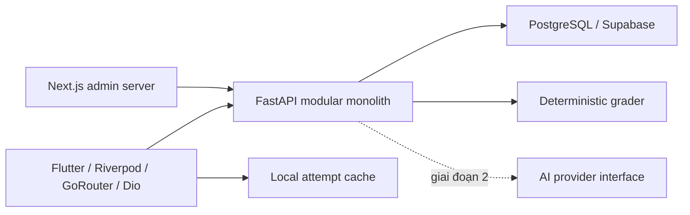

# Kiến trúc

API dùng SQLAlchemy; SQLite là chế độ phát triển cục bộ, PostgreSQL là đích production. Migration Supabase độc lập thiết lập RLS. Không coi kiểm thử SQLite là kiểm thử RLS.

Guest sở hữu attempt qua capability token ngẫu nhiên; server lưu hash, không trả token trong listing và không log token. Mobile giữ token cục bộ và gửi qua header. Câu hỏi công khai không chứa đáp án/rubric. Server đóng băng đề vào attempt, chấm một lần trong transaction. Admin development token chỉ sử dụng ở localhost; production phải dùng JWT Supabase đã xác minh và role lưu trong DB.

Auth/Storage Supabase, phụ huynh, giáo viên, OCR, tải tài liệu và đồng bộ nhiều thiết bị chưa triển khai. AI keys chỉ thuộc backend. Dữ liệu học sinh không được dùng để huấn luyện.
